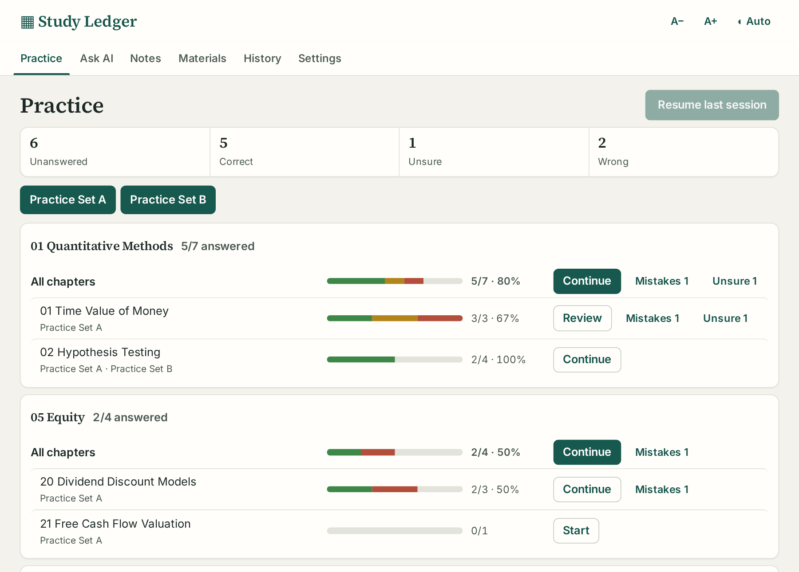
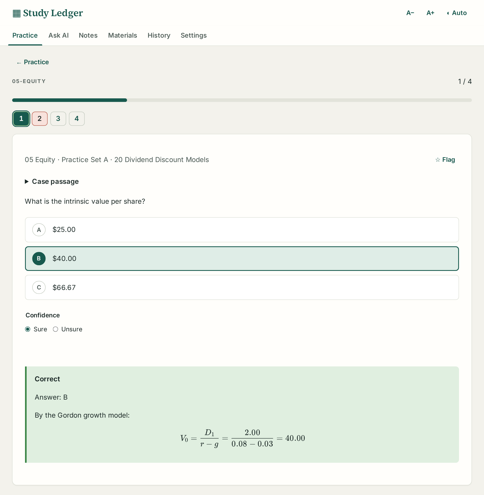
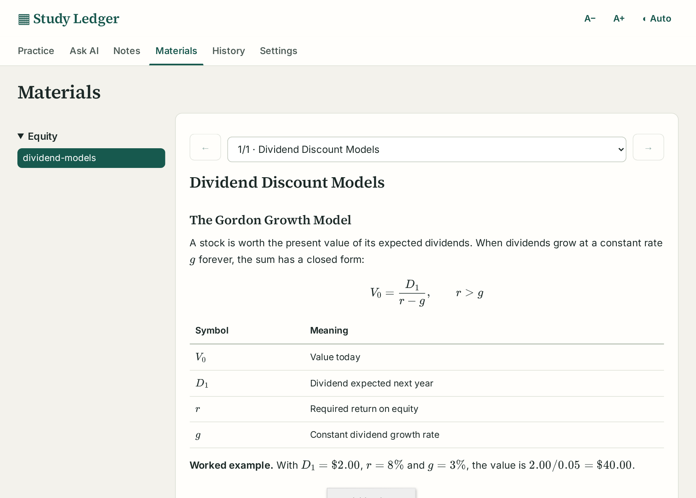
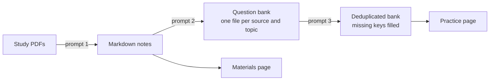

# Question Bank Prep

**A self-hosted practice app for the CFA® exam and other multiple-choice exams, with an AI tutor built in.** Keep your question banks as plain Markdown, practise them by topic and chapter, see exactly where you lose marks, and get hints, explanations and a study review from an AI tutor that reads and cites your own notes. Three [ready prompts](#build-a-bank-from-your-pdfs-three-prompts) let an AI agent turn your study PDFs into notes and a clean question bank. New here? Start with the [user guide](docs/user/user-guide.md).

[](https://github.com/GerardWu100/question-bank-prep/actions/workflows/tests.yml)
[](https://github.com/GerardWu100/question-bank-prep/pkgs/container/question-bank-prep)

[](LICENSE)

<picture>
  <source media="(prefers-color-scheme: dark)" srcset="docs/images/practice-dark.png">
  
</picture>

## Why

Commercial question banks lock your answers inside their site, and generic flashcard apps do not understand item sets, exhibits or formulas. This app keeps the questions in files you own and the study record on your own machine:

- **Practice by topic and chapter.** Every chapter shows a progress bar (green correct, amber unsure, red wrong), accuracy, and one-click **Mistakes**, **Unsure** and **★ Flagged** sets. **Resume last session** returns to the exact question you left.
- **Real exam formats.** Standalone questions and CFA-style item sets: a case passage with exhibits and tables, followed by its questions. Formulas render with KaTeX; diagrams with Mermaid.
- **Confidence, not just right or wrong.** Mark an answer *unsure*, and a lucky guess goes to the Unsure set instead of hiding among correct answers.
- **Your bank stays plain Markdown.** Point the app at a folder; it syncs every time you open it and keeps your answer history when a file is edited or re-extracted.
- **Read your notes beside the questions.** The Materials page shows your study notes (Markdown, math, images), one section at a time.
- **An AI tutor beside every question and note section.** See [AI features](#ai-features) below.
- **Three ready prompts build the bank for you.** Give them to an AI coding agent to turn study PDFs into notes and a clean question bank. See [Build a bank from your PDFs](#build-a-bank-from-your-pdfs-three-prompts).
- **Self-hosted and private.** One Docker image for PCs, servers and Raspberry Pi; one SQLite file holds every answer, note and chat. Practice works without the AI.

<p>
<picture>
  <source media="(prefers-color-scheme: dark)" srcset="docs/images/question-dark.png">
  
</picture>
<picture>
  <source media="(prefers-color-scheme: dark)" srcset="docs/images/reader-dark.png">
  
</picture>
</p>

## AI features

The tutor sits under each practice question, beside each section of your notes, and on its own **Ask AI** page.

| Feature | What it does |
|---|---|
| **Hint** | Before you answer: one hint at a time, and the tutor cannot see or reveal the key or solution |
| **Explain** | After you answer: the concept tested, why the key is right, why each other choice is wrong, starting with the one you picked |
| **Explain this section** | On the Materials page: the section in plain language, every symbol in each formula, and a worked example with numbers |
| **Review my study** | Reads your results by chapter, your mistakes, the questions you asked and your notes; names your weak concepts and the next three chapters to practise |
| **Cites your notes** | Searches your study notes (ripgrep, file list, line reader; read only) and ends each answer with the file and section it used |
| **Calculator** | Works numbers out in a bounded Python calculator instead of mental arithmetic |
| **Saved conversations** | Each question and note section keeps its own chat; **History** lists them all, and any reply can be saved as an AI note |
| **AI answer keys** | Prompt 3 fills keys a source left out, marked `Answer (AI)` in the file, and never overwrites a source key |

It runs on the ChatGPT subscription you already have: the app reads the existing Codex login, so there is no API key and no per-token bill. Pick any model your account offers, and its thinking level, in Settings. Only the current question or note section, the recent messages of that chat, and what the tutor looks up are sent. Practice works fully without AI.

## Build a bank from your PDFs: three prompts

You do not type questions in. Open an AI coding agent (such as Claude Code or Codex) in your own study folder, fill in the short **Settings** block at the top of each prompt (exam name, folders, the file that lists your topics and chapters), and send it. The prompts work for any exam; nothing in them is CFA-specific.

| Step | Prompt | What you get |
|---|---|---|
| 1 | [PDF → Markdown](docs/prompts/pdf-to-markdown.md) | Faithful Markdown notes with formulas, tables and diagrams, shown on the Materials page |
| 2 | [Extract questions](docs/prompts/extract-questions.md) | Multiple-choice questions copied word for word into `question_bank/<NN-topic>/<source>.md`, checked with `npm run check-bank` |
| 3 | [Review the bank](docs/prompts/review-questions.md) | Duplicates and near-duplicates removed (`npm run find-duplicates`), and missing keys filled under an `Answer (AI)` heading that never replaces a source key |

Keep your study folder private when it holds copyrighted material; this repository holds only the prompts.



A question is ordinary Markdown ([format guide](docs/user/question-format.md)):

```markdown
## Question 1
What is the present value of \$500 received in 2 years at 5%?

### Choices
A. \$453.51
B. \$476.19
C. \$551.25

### Answer
A

### Solution
$PV = 500 / 1.05^2 = 453.51$.
```

## Run with Docker

You need a computer that stays on, with [Docker](https://docs.docker.com/engine/install/). No clone and no build: the image is published for ordinary PCs and servers (amd64) and Raspberry Pi or ARM servers (arm64).

### Option A: Docker Compose (recommended)

Save this as `docker-compose.yml` in an empty folder, and put `STUDY_PASSWORD=<a password>` in a file named `.env` beside it:

```yaml
services:
  question-bank-prep:
    image: ghcr.io/gerardwu100/question-bank-prep:latest
    container_name: question-bank-prep
    restart: unless-stopped
    user: "1000:1000"                 # your `id -u`:`id -g`
    ports:
      - "6848:3000"                   # web page at http://<server>:6848
    environment:
      - TZ=America/Toronto
      - STUDY_PASSWORD=${STUDY_PASSWORD}
      - AI_MAX_REQUESTS_PER_HOUR=60   # cap on Codex use by the whole app
      - AI_MAX_REQUESTS_PER_DAY=300
    volumes:
      - ~/.containers/question-bank-prep:/data              # database and backups
      - ~/projects/cfa/question_bank:/question_bank:ro      # question banks
      - ~/projects/cfa/md_materials:/materials:ro           # study notes
      # Codex login, for the tutor: the login file and model list only, not all of ~/.codex
      - type: bind
        source: ${HOME}/.codex/auth.json
        target: /codex/auth.json
        read_only: true
        bind: { create_host_path: false }
      - type: bind
        source: ${HOME}/.codex/models_cache.json
        target: /codex/models_cache.json
        read_only: true
        bind: { create_host_path: false }
```

Then start it from that folder:

```bash
docker compose up -d
```

A [fully commented version](docker-compose.example.yml) of this file is in the repository too. It also joins a Docker network named `single`, where a reverse proxy can reach it. [`docker-compose.yml`](docker-compose.yml) builds the same service from a checkout.

### Option B: one `docker run` command

```bash
docker run -d --name question-bank-prep --restart unless-stopped \
  --user 1000:1000 -p 6848:3000 \
  -e TZ=America/Toronto -e STUDY_PASSWORD=change-me \
  -v ~/.containers/question-bank-prep:/data \
  -v ~/projects/cfa/question_bank:/question_bank:ro \
  -v ~/projects/cfa/md_materials:/materials:ro \
  --mount type=bind,src=$HOME/.codex/auth.json,dst=/codex/auth.json,readonly \
  --mount type=bind,src=$HOME/.codex/models_cache.json,dst=/codex/models_cache.json,readonly \
  ghcr.io/gerardwu100/question-bank-prep:latest
```

### Before you start: what to check

| Check | Why | What to change |
|---|---|---|
| The left side of each volume line | Those are the folders on your computer | Your `question_bank`, `md_materials` and Codex files; leave out the notes or both Codex entries to run without that feature |
| Codex login files exist | Only `~/.codex/auth.json` and `~/.codex/models_cache.json` go into the container, never the rest of `~/.codex`; the container refuses to start if either is missing | Sign in to Codex with ChatGPT and open it once; after `codex logout` and a new login, restart the container |
| `AI_MAX_REQUESTS_PER_HOUR`, `AI_MAX_REQUESTS_PER_DAY` | Caps how many Codex requests the whole app sends (default 60 an hour, 300 a day), so a leaked password cannot drain your ChatGPT plan | Raise them if the tutor stops you during normal study; `0` turns a cap off |
| Run `id -u` and `id -g` | The database should belong to you, and the Codex login is readable only by you | If either is not `1000`, change `user:` |
| `STUDY_PASSWORD` | The container listens beyond the server itself, so the app refuses to start without a password (Compose also refuses to start without it) | Set it in `.env` |
| `TRUST_PROXY` | Behind a reverse proxy that serves HTTPS, the login cookie should be marked Secure | Set `TRUST_PROXY=true` only in that case; leave `false` when the app is reached directly |

Then open **`http://<server address>:6848`** and sign in. The question folder syncs every time the app opens; the database lives in `/data`.

### Update

| Installed with | Update with |
|---|---|
| Compose | `docker compose pull && docker compose up -d` |
| `docker run` | `docker pull ghcr.io/gerardwu100/question-bank-prep:latest`, then `docker rm -f question-bank-prep`, then the same `docker run` command again |

Your progress, chats and notes live in `/data`, not in the container, so updating never loses them. **Pin a version** by replacing `latest` with `1`, `1.0` or `1.0.0` once releases are tagged (`git tag v1.0.0 && git push --tags` publishes them).

## Run without Docker

Requires Node.js 24 or newer and npm. Native SQLite installation requires a working C++ toolchain when no matching binary is available.

```sh
npm ci
npm run build
npm start
```

Open `http://127.0.0.1:3000`. The default binds only to this computer. Copy `.env.example` to `.env` to set a password, storage directory, port or existing material folder. The app refuses a non-loopback listener without a password. Use HTTPS through a trusted reverse proxy for remote hosting.

For interface development, run `npm run dev` and `npm run dev:web` in separate terminals, then open `http://127.0.0.1:5173`.

## Prepare a bank

Set `MATERIAL_ROOT` in `.env` to a folder of bank files: the app syncs it every time a library opens (Settings → Sync folder now forces it), and the manual import panel is hidden. Without a folder, import Markdown through Materials. Select `note` for reading material without question headings. **The full format guide is [docs/user/question-format.md](docs/user/question-format.md)**, with working examples in [examples/](examples). In short:

```markdown
# Chapter 1

## Question 1
What is two plus two?

### Choices
A. Three
B. Four
C. Five

### Answer
B

### Solution
Two pairs make four.
```

Put `Question` headings one level below a `Case` heading to share its passage. Keep choice, answer and solution headings one level deeper than the question. Preview reports missing keys and structural errors before committing; `npm run check-bank -- <file-or-folder>` runs the same checks from the command line. Missing keys remain readable but cannot be graded. Choices never shuffle. Review sets retain their membership and order after answers change.

The Practice page has one toggle per source (switch a source off to practise only the others; remembered per browser) and lists every topic as a foldable panel (all open until you fold one), with an "All chapters" line and one line per chapter (sources are merged; each chapter names its sources in small text), each with a progress bar (green correct, amber unsure, red wrong), answered/total and accuracy. **Start / Continue / Review** reopens that chapter's set where you left off (the first unanswered question); **Mistakes** and **Unsure** (shown when there are any) build sets of your wrong and unsure-but-correct questions; one central **★ Flagged** button at the top practises all starred questions from every source, even sources switched off. Unsure answers count as correct in the accuracy figure. After a wrong answer, a small **Misclicked** button beside Previous/Next re-saves the key so a slip does not land in Mistakes. Answers are remembered across sets: a question you answered anywhere shows your latest answer and its solution. A folded **Custom practice set** builder filters by **Topic** (the bank's folder, such as `01-quantitative-methods`), **Source** (the file name) and **Chapter**; each option shows answered/total. The number strip colours finished questions by result (green correct, amber unsure, red wrong). The URL keeps the current page and open set, so refresh stays in place and the browser Back button returns to the previous view. Free-form notes live on the **Notes** page (Markdown, editable), with separate **My notes** and **AI notes** (saved tutor replies) tabs; any note can be deleted after a confirmation. **Settings → Export** downloads my notes and AI notes (Markdown) and progress (CSV, one row per answered question: topic, source, chapter, your answer, key, result, flag). There is no per-question note box.

Set `READING_ROOT` in `.env` to a folder of Markdown study material (for example `cfa/md_materials`) to read it on the **Materials** page: files grouped by folder, long files split into sections with Previous/Next (a whole-curriculum file whose top headings are the CFA topics opens as one section per topic), images and Mermaid diagrams shown, last place remembered, and an **Ask AI about this section** box under each section that sends that section to the tutor as context (the conversation is saved per section). It is read-only; the upload import appears there only when no `MATERIAL_ROOT` is set. The header has **A− / A+** (text size) and a theme switch (Auto, Light, Dark), remembered per browser; both themes keep body text at high contrast and use bundled fonts, so the app looks the same on every device. Sources are read-only in the app; there is no editor and no Progress page. The app tracks two distinct answers: the latest overall answer, and the answer within each set. A set without its own answer for a question shows the latest overall answer; answering again in a set updates both. Sure/Unsure applies only to correct answers. A saved response means done, not mastery.

**Resume last session**, at the top of Practice, reopens the last set used in this browser for the selected library at its exact saved question, even if that question is answered. It does not create a new set. The button is disabled until a valid session exists; the selected library is remembered after reload. Chapter **Start / Continue** keeps its existing first-unanswered behavior. Four compact result counters appear above the topic list, and topic/chapter controls and collapsed note cards use less vertical space; the fonts and reading/question layouts are unchanged.

## AI and calculator

AI uses the existing Codex ChatGPT subscription login read-only through the pinned pi-ai adapter. It does not refresh or copy credentials and has no API-key billing fallback. Codex remains the credential refresh owner. In Docker only the login file and model list are mounted, not the whole `~/.codex` folder. Every model request (one per reply plus one per tool round) counts toward a project-wide cap, `AI_MAX_REQUESTS_PER_HOUR` (default 60) and `AI_MAX_REQUESTS_PER_DAY` (default 300), kept in `codex-usage.json` in the data folder so a restart does not reset it; past the cap the tutor says when it can answer again. The app checks the local account model catalog and disables unavailable models; reopen Codex if its catalog or login has expired. Only explicitly sent context and retrieved excerpts go to the provider. Every model Codex lists for your account is offered; pick the tutor model and its **Thinking** level (the levels Codex lists for that model) once on **Settings → AI model** (stored with the library; defaults `gpt-6.1-sol` and the model's Codex default level). The chat box has no model picker: Enter sends, Shift+Enter adds a line. **Review my study** (Ask AI page) has the tutor read your per-chapter results and mistakes, the questions you asked it, and your notes, then name your weak concepts and the next 3 chapters to practise. **Hint** (before you answer) and **Explain** (after you answer, and under each material section) send a ready-made request. With `READING_ROOT` set, the tutor can search your study notes (a read-only `rg`, or a built-in `search_study_notes` where ripgrep is not installed, plus `list_files` like ls/find and `read_file` by line offset, all locked to that folder; no general shell) to cite the exact file and section; these tools are off in hint mode because the notes include solved question banks. When the model returns a reasoning summary, the reply shows a folded **Reasoning** line above it. The tutor writes math with `$`/`$$` (`\[ \]` and `\( \)` are converted too) and ends with a `Source:` line naming the notes or library sources it used (left out under a practice question when it used only that question). After you answer, the tutor also sees your choice and whether it was right, so Explain addresses your mistake. Ask AI sits directly below each practice question; the conversation is saved per question (your messages and the tutor's replies, with model and sources) and reopens when you return to that question, and History lists every conversation. Before you answer, hint-mode messages are shown only in the set where they were written.

The calculator uses a disposable Pyodide worker with time and output limits. It needs no Docker. This is practical local containment, **not an operating-system sandbox** or a hard host memory limit. Do not expose it to untrusted public users.

## Back up and restore

```sh
npm run backup -- backup app-data/study.sqlite app-data/backups/study.sqlite
npm run backup -- restore app-data/backups/study.sqlite app-data/restored/study.sqlite
```

The snapshot contains imported source versions and all database records; it does not copy credentials or unrelated external-folder files. Keep its adjacent checksum manifest. Restore accepts only a new destination, verifies the checksum and SQLite integrity, and never overwrites a live database. Stop the app before switching `STUDY_DATA_DIR` to the restored directory (name the restored file `study.sqlite`). Logins are stored in the database (as hashes), so they survive restarts; restoring a backup restores its logins too.

Local-folder editor saves retain journals under the data directory until reimport succeeds. Settings shows pending recovery. If an external editor changes the file, resolve the conflict before retrying; the app does not silently discard that edit.

## Verify

The test image runs the type check, unit tests, production build and Chromium browser tests on Node 24 (Linux):

```sh
docker build --target test -t question-bank-prep-test .
docker run --rm question-bank-prep-test
```

Or natively:

```sh
npm run typecheck
npm test
npm run build
npx playwright install chromium
npm run test:e2e
```

Tests use synthetic material and the files in `examples/`, not a proprietary bank. Browser tests use the production build on port 3100, a fresh temporary database, and bundled reading fixtures; they refuse to reuse a running server. Run the build first. The default `npm run test:e2e` runs each spec file with a fresh server so cumulative test traffic does not exhaust the production request limit. To run one focused selection, use `npm run test:e2e -- tests/e2e/resume.spec.ts`; explicit arguments are passed to one Playwright invocation. See [GUIDE_ROOT.md](GUIDE_ROOT.md) for architecture, known limits and acceptance evidence.

## License and trademarks

[MIT](LICENSE): free to use, change and share, including commercially, as long as the copyright notice stays with the code. The license covers this repository's code and documents, not the question banks or study material you load into the app. CFA® and Chartered Financial Analyst® are trademarks owned by CFA Institute. This project is not affiliated with or endorsed by CFA Institute, and it ships no exam questions: the screenshots use an original demo bank.
