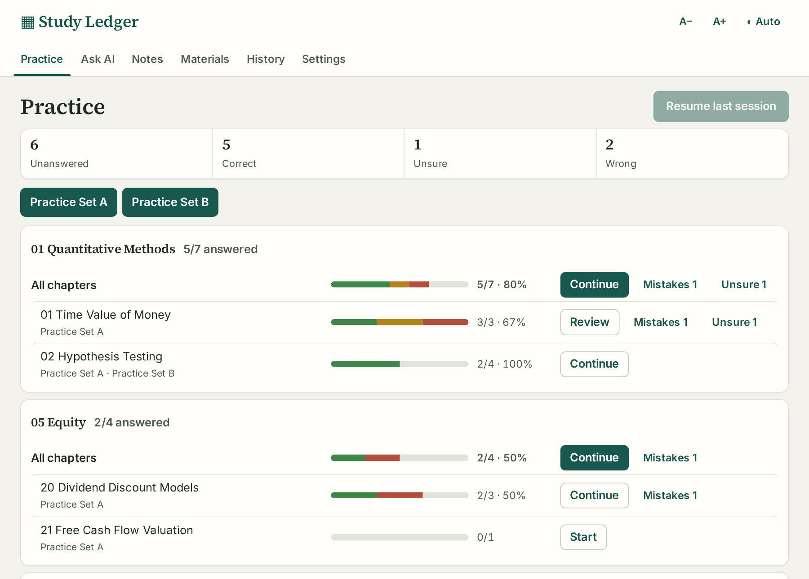
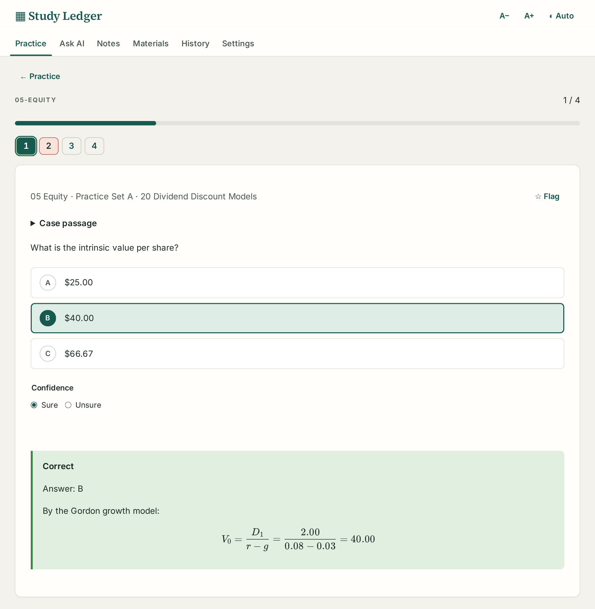
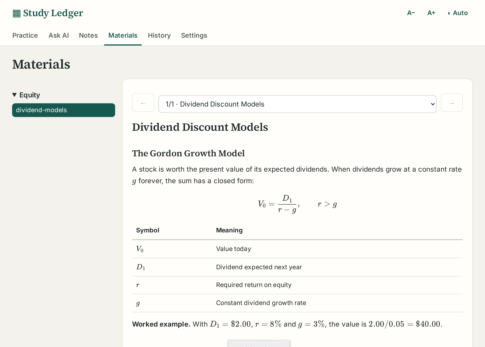

# Question Bank Prep : une application d'entraînement au CFA® en Markdown simple

J'ai réussi le niveau I du CFA® et je prépare maintenant le niveau II. Je passe l'essentiel de mon temps d'étude sur des questions d'entraînement, et les outils que j'ai essayés me gênaient plus qu'ils ne m'aidaient. J'ai donc créé [Question Bank Prep](https://github.com/GerardWu100/question-bank-prep), une application d'entraînement pour l'examen CFA et d'autres examens à choix multiples. Elle tourne comme application de bureau sous Linux, macOS et Windows, ou comme conteneur Docker sur un serveur domestique.

## Le problème

Les banques de questions commerciales gardent vos réponses sur leur site, et l'historique de vos erreurs disparaît avec l'abonnement. Les applications de cartes mémoire échouent dans l'autre sens. Les cartes vous appartiennent, mais une carte ne contient qu'une question et une réponse. Le niveau II repose sur des études de cas (*item sets*) : un texte de cas avec des annexes, puis plusieurs questions qui en dépendent, dont beaucoup demandent une formule. Cela ne tient pas sur une carte.

L'application garde donc les questions dans des fichiers Markdown qui vous appartiennent, conserve l'historique d'étude sur votre machine et ajoute un tuteur IA qui explique à partir de vos propres notes.

## Ce que fait l'application

Sur la page Practice, chaque thème et chaque chapitre ont une barre de progression divisée en réponses correctes (vert), incertaines (ambre) et fausses (rouge), avec à côté des révisions Mistakes et Unsure en un clic. Toutes les captures d'écran utilisent une banque de démonstration originale, pas du matériel d'examen.

Le dossier des banques fixe la structure : son premier sous-dossier donne le thème, le nom du fichier donne la source, et les titres `Chapter` donnent le chapitre. Trois séries de révision (Mistakes, Unsure et Flagged) couvrent toutes les sources. La page Materials affiche vos notes d'étude, et un tuteur IA se trouve sous chaque question et chaque section de notes, mais l'entraînement fonctionne entièrement sans lui. L'application de bureau (une version Electron) et l'image Docker protégée par mot de passe lisent sur place les deux mêmes dossiers : banques de questions et notes.

## Une banque de questions est un fichier Markdown

L'application lit les titres d'une banque et traite tout le reste comme du Markdown ordinaire. L'exemple de cas fourni se présente ainsi :

| Ligne du fichier | Ce qu'en fait l'analyseur |
|---|---|
| `# Chapter 3 Equity Valuation` | Fixe le chapitre des questions qui suivent et ferme tout cas ouvert |
| `## Case Maple Leaf Utilities` | Ouvre un texte partagé ; un tableau d'annexe sous un titre plus profond y reste |
| `### Question 1` | Ouvre une question ; l'énoncé va jusqu'au sous-titre suivant |
| `#### Choices`, puis des lignes `A.`, `B.`, `C.` | Un choix par étiquette, lettres dans l'ordre |
| `#### Answer`, puis `B` | La clé ; `B.`, `(B)`, `**B**` et `Answer: B` fonctionnent aussi |
| `#### Answer (AI)` | Une clé ajoutée par une IA faute de clé dans la source ; elle note normalement mais reste marquée |
| `#### Solution` | Affichée seulement après votre réponse |

L'analyseur construit un arbre syntaxique Markdown avec remark et ne regarde que les vrais nœuds de titre. Un titre placé dans un exemple de code délimité ne peut donc pas créer de question. Il découpe le texte d'origine entre les titres, ce qui garde intactes les formules et les choix sur plusieurs lignes. Une ligne de choix ne compte que si sa lettre est la suivante dans l'ordre : un énoncé en chiffres romains comme « I. Only statement one » à l'intérieur du choix C reste donc dans C.

Moins de deux choix distincts est une erreur qui bloque l'import. Une clé absente ou ambiguë comme `A or B` n'est qu'un avertissement : la question est importée mais reste impossible à noter, car l'application ne devine jamais une note. Le même analyseur tourne en ligne de commande (`npm run check-bank`) et renvoie le code de sortie 1 à la moindre erreur. Un agent IA qui extrait des questions de PDF à l'aide des prompts du dépôt peut ainsi repérer ses propres erreurs.

Chaque question reçoit aussi une empreinte : un hachage SHA-256 de son texte de cas, de son énoncé et de ses choix, espaces normalisés. La clé et la solution n'entrent pas dans le hachage. Quand je corrige une clé fausse et que je réimporte le fichier, la question garde son identité et ma réponse enregistrée est notée à nouveau. Quand l'énoncé ou les choix changent, l'application demande avant de reporter la progression. Elle ne reporte jamais une réponse sur des choix modifiés, puisqu'un « B » enregistré voudrait alors dire autre chose.

## Pourquoi « incertain » n'est pas « correct »

Une question à choix multiples du CFA a trois options : un choix au hasard est juste une fois sur trois. Une bonne réponse mêle donc ce que vous savez et la chance. Soit $k$ la part des questions d'un chapitre que vous savez vraiment, et $m$ le nombre d'options. On suppose que vous réussissez toujours une question connue et que vous répondez au hasard sinon. Alors

$$
P(\text{correct}) = k \cdot 1 + (1-k) \cdot \frac{1}{m}
$$

Par la règle de Bayes, la part des bonnes réponses dues à la chance est le terme de chance divisé par le total :

$$
P(\text{guess} \mid \text{correct}) = \frac{(1-k)/m}{k + (1-k)/m}
$$

Exemple chiffré avec $k = 0.6$ et $m = 3$ :

- terme de chance : $(1 - 0.6)/3 = 0.133$
- score : $P(\text{correct}) = 0.6 + 0.133 = 0.733$
- part de chance dans le score : $0.133 / 0.733 = 0.18$

Un score de 73 % sur un chapitre que vous maîtrisez à 60 % cache donc environ une réponse chanceuse sur cinq (à titre d'illustration, pas mes données d'étude). Une révision de vos erreurs ne vous montre jamais ces questions.

Après la réponse, la page affiche le résultat, la clé et la solution de la source. Le choix Sure/Unsure reste ouvert pour que vous puissiez encore le changer, et le texte du cas se replie au-dessus de l'énoncé.

Dans le code, la fonction `grade` fait d'« incertain » un statut à part entière, à côté de correct, faux, sans réponse et impossible à noter. Seule une bonne réponse peut être incertaine ; une réponse fausse efface la confiance. Le pourcentage du chapitre compte quand même les réponses incertaines comme justes, comme le ferait l'examen. La barre les affiche en ambre, et la série Unsure les rassemble. La confiance reste déclarative : l'application ne peut pas repérer un coup de chance dont vous étiez sûr.

## Un tuteur ancré dans vos notes

Le serveur choisit l'un des deux modes du tuteur. Avant votre réponse, le serveur n'envoie ni la clé ni la solution au navigateur, et le tuteur est en mode indice : un indice à la fois. Ses résultats d'outils retirent la clé et la solution de toutes les questions, et l'index plein texte des questions ne contient que le texte du cas, l'énoncé et les choix. Les outils qui lisent vos notes d'étude sont désactivés, car un dossier de notes peut contenir des banques de questions corrigées.

Après votre réponse, le tuteur voit votre choix, la clé et la solution. Il peut aussi lancer un ripgrep en lecture seule et lire des lignes numérotées de vos notes, sans sortir du dossier de notes et sans shell général. **Review my study** lit vos erreurs par chapitre, vos questions passées et vos notes enregistrées, puis nomme vos concepts faibles et les trois prochains chapitres à travailler. Le prompt système traite tout le matériel comme des données non fiables et demande au tuteur de finir par une ligne `Source:` qui nomme le fichier et la section utilisés. Les citations d'éléments de la bibliothèque renvoient à des révisions immuables : une ancienne conversation ouvre toujours le texte exact qu'elle citait, même après la modification d'une note. Pour l'arithmétique, le tuteur appelle une calculatrice qui exécute du Python avec Pyodide dans un nouveau processus Node, où le modèle de permissions de Node bloque la lecture de la base de données et des clés d'API.

La page Materials affiche les notes une section à la fois, avec des formules KaTeX et des tableaux. Le chat Explain de chaque section envoie cette section au tuteur comme contexte.

Les connexions (un abonnement ChatGPT, Anthropic, OpenAI, OpenRouter ou tout point d'accès compatible OpenAI) forment une liste ordonnée : si l'une échoue avant de répondre, la suivante répond. Des plafonds par défaut de 30 requêtes par heure et 150 par jour empêchent un mot de passe divulgué de vider un forfait. Le mode indice ne peut pas empêcher un modèle puissant de résoudre une question visible avec ses connaissances générales. L'application garantit seulement qu'elle ne donne jamais la clé au modèle.

## Où vit la progression

Toute la progression tient dans un seul fichier SQLite. Les enregistrements y sont stockés en JSON par type (questions, fichiers, séries, conversations, notes et leurs révisions), à côté d'un index plein texte FTS5. Chaque question garde votre dernier choix, sa confiance, un drapeau, une note et un numéro de séquence de réponse, qui sert à l'ordre de pratique « Older ».

Pour changer d'appareil, **Settings → Export** écrit un fichier JSON avec les réponses, la confiance, les drapeaux et les notes. Les banques n'y sont pas : vous chargez d'abord la même banque sur la nouvelle installation. L'import associe chaque entrée par empreinte, puis par chemin de fichier, chapitre, cas et numéro quand plusieurs questions ont le même contenu. Les entrées qui ne correspondent à aucune question, ou à plusieurs, sont listées et ne sont pas appliquées. Les réponses sont rejouées dans leur ordre d'origine, si bien que l'ordre « Older » survit au transfert.

Les sauvegardes (`npm run backup`) incluent un manifeste de somme de contrôle, et la restauration n'écrase jamais une base active. Les clés d'API sont dans un fichier de réglages séparé, lisible par son seul propriétaire, hors de la base et de ses sauvegardes.

## Limites

- Seule la version de bureau Linux a tourné sur une vraie machine. Les installeurs macOS et Windows ne sont ni signés ni testés, pas plus que Firefox, WebKit (le moteur de Safari) ou les téléphones.
- La recherche se fait par mots-clés (FTS5 et ripgrep) : une paraphrase peut manquer la bonne note.
- C'est à vous de construire la banque. Les prompts font l'essentiel du travail, mais gardez le dossier d'étude privé s'il contient du matériel protégé par le droit d'auteur. Le dépôt ne contient aucune question d'examen.

Le code est sous licence MIT sur [GitHub](https://github.com/GerardWu100/question-bank-prep).

*CFA® et Chartered Financial Analyst® sont des marques de CFA Institute. Ce projet n'est ni affilié à CFA Institute ni approuvé par lui.*
