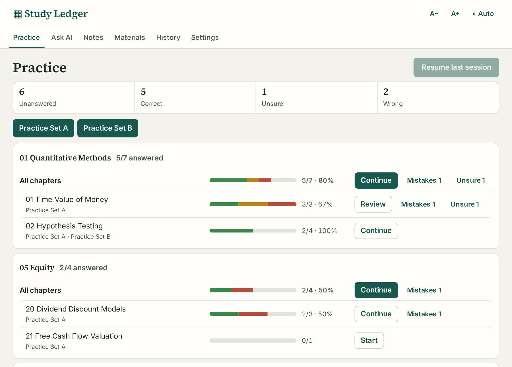
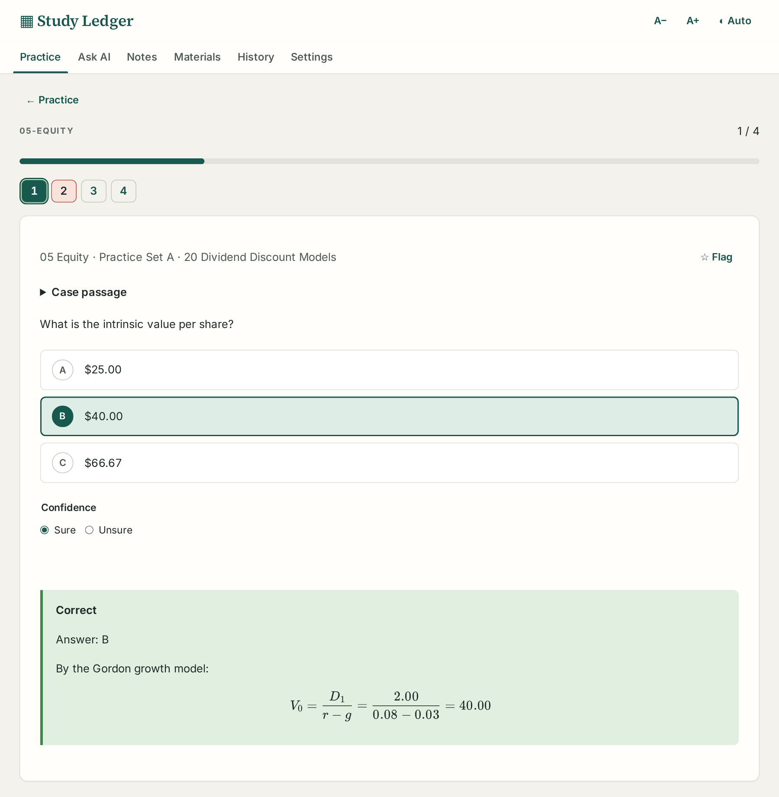
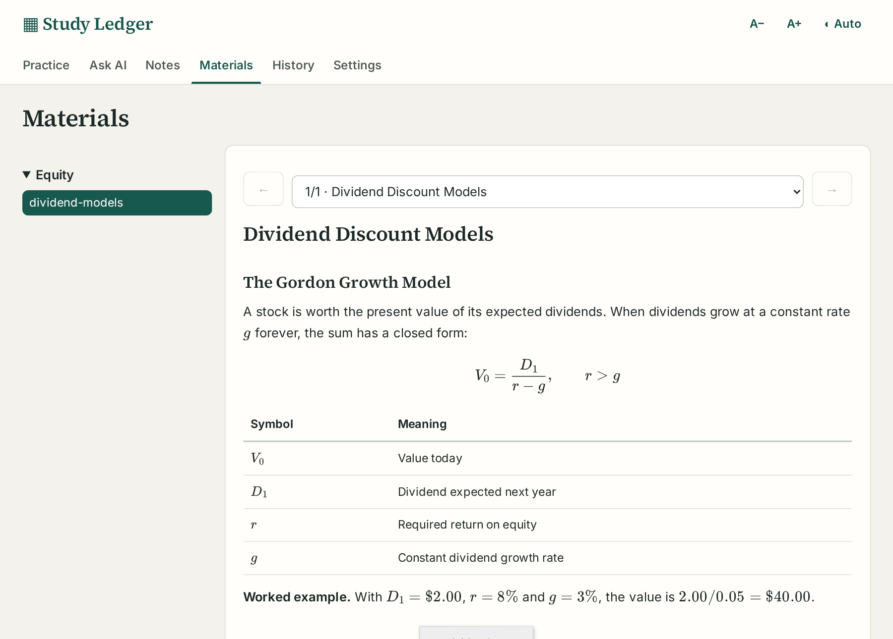

# Question Bank Prep: a CFA® practice app built on plain Markdown

I passed CFA® Level I and I am now studying for Level II. Most of my study time goes into practice questions, and the tools I tried kept getting in the way, so I built [Question Bank Prep](https://github.com/GerardWu100/question-bank-prep). It is a practice app for the CFA exam and other multiple-choice exams. It runs as a desktop app on Linux, macOS and Windows, or as a Docker container on a home server.

## The problem

Commercial question banks keep your answers on their site, and the record of what you got wrong ends with the subscription. Flashcard apps fail in the other direction. You own the cards, but a card holds one prompt and one answer. Level II is built from item sets: a case passage with exhibits, then several questions that depend on it, many of them needing a formula. That does not fit on a card.

So the app keeps the questions in Markdown files you own, keeps the study record on your machine, and adds an AI tutor that explains from your own notes.

## What the app does

On the Practice page, each topic and chapter has a progress bar split into correct (green), unsure (amber) and wrong (red) answers, with one-click Mistakes and Unsure reviews beside it. All screenshots here use an original demo bank, not exam material.

The bank folder sets the structure: its first subfolder is the topic, the file name is the source, and `Chapter` headings set the chapter. Three review sets (Mistakes, Unsure and Flagged) span every source. The Materials page shows your study notes, and an AI tutor sits under every question and note section, though practice works fully without it. The desktop app (an Electron build) and the password-protected Docker image both read the same two folders in place: question banks and materials.

## A question bank is a Markdown file

The app reads a bank's headings and treats everything else as normal Markdown. The bundled case example looks like this:

| Line in the file | What the parser does with it |
|---|---|
| `# Chapter 3 Equity Valuation` | Sets the chapter for the questions below and ends any open case |
| `## Case Maple Leaf Utilities` | Starts a shared passage; an exhibit table under a deeper heading stays in it |
| `### Question 1` | Starts a question; the stem runs to the next sub-heading |
| `#### Choices`, then `A.`, `B.`, `C.` lines | One choice per label, letters in order |
| `#### Answer`, then `B` | The key; `B.`, `(B)`, `**B**` and `Answer: B` also work |
| `#### Answer (AI)` | A key an AI added because the source had none; it grades normally but stays marked |
| `#### Solution` | Shown only after you answer |

The parser builds a Markdown syntax tree with remark and looks only at real heading nodes, so a heading inside a fenced code example cannot create a question. It slices the original text between headings, which keeps math and multi-line choices intact. A choice line counts only when its letter is the next one in order, so a Roman-numeral statement such as "I. Only statement one" inside choice C stays part of C.

Fewer than two distinct choices is an error that blocks the import. A missing or ambiguous key such as `A or B` is only a warning: the question imports but stays ungradable, because the app never guesses a grade. The same parser runs from the command line (`npm run check-bank`) and exits with status 1 on any error, so an AI agent extracting questions from PDFs, using the prompts in the repository, can catch its own mistakes.

Each question also gets a fingerprint: a SHA-256 hash of its case text, stem and choices, with whitespace collapsed. The key and solution are left out of the hash. When I fix a wrong key and re-import the file, the question keeps its identity and my saved answer is regraded. When the stem or choices change, the app asks before carrying progress over. It will not carry an answer across changed choices, since a saved "B" would then mean something else.

## Why "unsure" is not "correct"

A CFA multiple-choice question has three options, so a blind guess is right one time in three. A correct answer mixes what you know with luck. Let $k$ be the share of questions in a chapter you really know, and $m$ the number of options. Assume you always get a known question right and guess at random otherwise. Then

$$
P(\text{correct}) = k \cdot 1 + (1-k) \cdot \frac{1}{m}
$$

By Bayes' rule, the share of correct answers that were lucky guesses is the lucky term divided by the total:

$$
P(\text{guess} \mid \text{correct}) = \frac{(1-k)/m}{k + (1-k)/m}
$$

Worked example with $k = 0.6$ and $m = 3$:

- lucky term: $(1 - 0.6)/3 = 0.133$
- score: $P(\text{correct}) = 0.6 + 0.133 = 0.733$
- luck inside the score: $0.133 / 0.733 = 0.18$

So a 73% chapter score, where you really know 60%, hides about one lucky answer in five (an illustration, not my study data). A pass over your mistakes never shows you those questions.

After you submit, the page shows the result, the key and the source solution. The Sure/Unsure choice stays open so you can still change it, and the case passage folds away above the stem.

In the code, the `grade` function makes unsure its own status, next to correct, wrong, unanswered and ungradable. Only a correct answer can be unsure; a wrong answer clears the confidence. The chapter percentage still counts unsure answers as correct, because the exam would. The bar shows them in amber, and the Unsure review set collects them. Confidence is self-reported, though, so the app cannot catch a guess you felt sure about.

## A tutor grounded in your notes

The server decides which of two modes the tutor runs in. Before you answer, the server does not send the key or the solution to the browser at all, and the tutor is in hint mode: one hint at a time. Its tool results strip the key and solution from every question, and the full-text index for questions holds only the case text, stem and choices. The tools that read your study notes are switched off, because a notes folder can contain solved question banks.

After you answer, the tutor sees your choice, the key and the solution. It can also run a read-only ripgrep and read numbered lines of your notes, locked to the materials folder with no general shell. **Review my study** reads your mistakes by chapter, your past questions and your saved notes, then names weak concepts and the next three chapters to practise. The system prompt treats all material as untrusted data and asks the tutor to end with a `Source:` line naming the file and section it used. Citations of library records point at immutable revisions, so an old chat still opens the exact text it cited after a note changes. For arithmetic, the tutor calls a calculator that runs Python through Pyodide in a fresh Node process, where Node's permission model blocks reads of the database and API keys.

The Materials page renders notes one section at a time, with KaTeX formulas and tables. Each section's Explain chat sends that section to the tutor as context.

Connections (a ChatGPT subscription, Anthropic, OpenAI, OpenRouter or any OpenAI-compatible endpoint) form an ordered list, and if one fails before replying, the next one answers. Default caps of 30 requests an hour and 150 a day keep a leaked password from draining a plan. Hint mode cannot stop a strong model from solving a visible question from general knowledge. What the app guarantees is that it never hands the model the key.

## Where progress lives

All progress sits in one SQLite file. Records are stored as JSON by kind (questions, files, sets, chats, notes and their revisions), next to an FTS5 full-text index. Each question record holds your latest choice, its confidence, a flag, a note and an answer sequence number that the "Older" practice order sorts by.

To move to another device, **Settings → Export** writes a JSON file of answers, confidence, flags and notes. It leaves the banks out, so you load the same bank on the new install first. Import matches each entry by fingerprint, then by file path, chapter, case and number when several questions share that content. Entries that fit no question, or several, are listed and left unapplied. Answers replay in their original order, so the "Older" order survives the move.

Backups (`npm run backup`) carry a checksum manifest, and restore never overwrites a live database. API keys live in a separate owner-only settings file, outside the database and its backups.

## Limits

- Only the Linux desktop build has run on a real machine. The macOS and Windows installers are unsigned and untested, as are Firefox, WebKit (Safari's engine) and phones.
- Search is keyword-based (FTS5 and ripgrep), so a paraphrase can miss the right note.
- You build the bank yourself. The prompts do most of the work, but keep the study folder private if it holds copyrighted material. The repository ships no exam questions.

The code is MIT-licensed on [GitHub](https://github.com/GerardWu100/question-bank-prep).

*CFA® and Chartered Financial Analyst® are trademarks of CFA Institute. This project is not affiliated with or endorsed by CFA Institute.*
