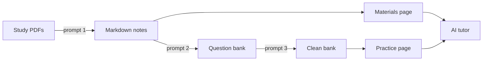

# Question Bank Prep: user guide

- **Code and issues:** <https://github.com/GerardWu100/question-bank-prep>
- **Docker image:** `ghcr.io/gerardwu100/question-bank-prep:latest` (amd64 and arm64)
- **Desktop app:** [latest release](https://github.com/GerardWu100/question-bank-prep/releases/latest) for Linux, macOS and Windows

Question Bank Prep is a self-hosted web app for practising multiple-choice exams such as the CFA® exam. Your questions stay in plain Markdown files that you own. The app grades your answers, tracks where you lose marks, shows your study notes, and has an AI tutor that uses your ChatGPT subscription through your Codex login, or your own API key (for example free OpenRouter models).



## 1. What you need

- The desktop app, or a computer that stays on, with Docker.
- A folder of question banks (Markdown). Step 4 below shows how to make one from your PDFs.
- Optional: a folder of Markdown study notes, for the Materials page.
- Optional, for the AI tutor: Codex signed in with ChatGPT on the same computer, or an API key (Anthropic, OpenRouter, OpenAI or similar).

## 2. Start the app

**Desktop app (one computer, no password).**

1. Download the installer for your system from the [latest release](https://github.com/GerardWu100/question-bank-prep/releases/latest).
2. Install it. The installers are not signed: on macOS right-click the app → **Open**; on Windows click **More info → Run anyway**; on Linux run `chmod +x` on the AppImage.
3. Open it and click **Create library**.
4. **Settings → Folders**: next to **Question banks**, click **Choose folder…** and pick your `question_bank` folder. Next to **Materials**, pick your notes folder (for the CFA, `md_materials`). The app restarts and reads both in place; nothing is copied. The same choices are in the **File** menu.

**Desktop app on your server's data.** If you run the Docker server below, choose **File → Connect to a server…** in the desktop app and enter the server's address. Questions, notes and progress then all come from the server; sign in with its password. **File → Use this computer (local data)** switches back.

**Server with Docker (reach it from any device, with a password).**

1. Make an empty folder. Save [docker-compose.example.yml](../../docker-compose.example.yml) in it as `docker-compose.yml`.
2. Change the left side of each `volumes` line to your own folders.
3. As yourself (not with `sudo`), make the data folder: `mkdir -p ~/.containers/question-bank-prep`. If it is missing, the start stops with "bind source path does not exist".
4. Make a file named `.env` in the same folder with three lines: `HOST_UID=` followed by the output of `id -u`, `HOST_GID=` followed by the output of `id -g`, and `STUDY_PASSWORD=<a password>`.
5. Start it:

   ```bash
   docker compose up -d
   ```

6. Open `http://<server address>:6848` and sign in with that password.

To update later: `docker compose pull && docker compose up -d`. Your answers, chats and notes live in the `/data` folder, so updates never lose them.

## 3. Use the app

| Page | What you do there |
|---|---|
| **Practice** | Pick a topic and chapter, then **Start**, **Continue** or **Review**. Mark an answer *unsure* if you guessed. **★ Flagged**, **✗ Mistakes** and **? Unsure** at the top review those questions from every source. **Resume last session** goes back to the exact question you left. On a question, Previous and Next stay at the top. |
| **Materials** | Read your study notes one section at a time. **Ask AI about this section** explains it. the round **↑** button jumps back up. Toggles (`<details>`) fold and unfold; code blocks have syntax colours and **Copy**. **↩ Back to …** (or the browser's Back) returns to the file you read before, at the same spot. |
| **Ask AI** | Free questions to the tutor, and **Review my study**: your weak concepts and the next three chapters to practise. |
| **Notes** | Your own notes and saved tutor replies, each with **Delete**. The AI notes tab has a chat box; **Continue this chat** reopens the conversation a note came from. |
| **History** | Every tutor conversation, grouped by where it started: Materials, Practice questions, or Ask AI. The buttons at the top show one group at a time (the app remembers your choice). **Delete** removes one conversation; saved AI notes stay. |
| **Guide** | This guide inside the app, with the three bank-building prompts ready to copy. |
| **Settings** | Export and **Import study progress**, Display (text size, theme: Auto, Light, Sepia, Dark or Dark sepia, line width, line spacing), Practice (show the answer on click), AI provider (Codex login or API key), tutor model and thinking level, and Folders (where question banks and materials come from). |

The app reads your question folder again each time you open it, and keeps your answer history when a file changes (**Settings → Folders → Sync now** forces it). On a server with no question-bank folder, **Settings → Folders → Upload a folder…** imports a whole bank folder into the library instead.

**Move your progress to another install** (for example from the server to the desktop app):

1. On the old install: **Settings → Export → Study progress (JSON)**.
2. On the new install, load the same question bank first.
3. **Settings → Import study progress** → choose that file. The app says how many answers, flags and notes it imported, and lists questions it could not find.

## 4. Build a bank from your PDFs: three prompts and an optional fourth

You do not type questions in. An AI coding agent (Codex, Claude Code or similar) does it with three prompts, plus an optional fourth that fixes charts. Keep your study folder in its own **private** Git repository, because it holds copyrighted material.

| Step | Prompt | Input | Output |
|---|---|---|---|
| 1 | [PDF → Markdown](../prompts/pdf-to-markdown.md) | `materials/` (PDFs) | `md_materials/`: faithful notes with formulas and tables |
| 2 | [Extract questions](../prompts/extract-questions.md) | `md_materials/` | `question_bank/<NN-topic>/<source>.md`: questions copied word for word |
| 3 | [Review the bank](../prompts/review-questions.md) | `question_bank/` | Duplicates removed; missing keys added under `Answer (AI)`; short explanations under `Intuition (AI)` |
| 4 (optional) | [Redraw charts](../prompts/redraw-charts.md) | `md_materials/`, `question_bank/` | Charts left as text art, text descriptions or page crops redrawn by code, in the notes and the bank |

How to run each prompt:

1. Open the prompt file and copy everything.
2. Fill in its **Settings** block: your repository URL, exam name, folders, and the file that lists your topics and chapters (the "outline").
3. Paste it into a new agent session. The agent pulls the repository, does the job, checks its own work, and commits and pushes.
4. For prompt 2, run one job per session: one source × one topic. Several sessions can run in parallel.
5. Run the prompts in order 1 → 2 → 3. Run prompt 3 again after you add a new source. Run prompt 4 only if some charts still show as text or blurry page crops.

Then point the app's `question_bank` and `md_materials` volumes at that repository's folders. An AI key never replaces a key from the source; the app shows it as AI-written.

The question format is in the [format guide](question-format.md).

## 5. The AI tutor

- **Hint** (before you answer): one hint at a time. The tutor cannot see the key or the solution.
- **Explain** (after you answer): why the key is right and why your choice was wrong.
- It searches your study notes and ends with the file and section it used.
- It only sends the current question or note section, recent messages of that chat, and what it looks up.
- Only one reply runs at a time. Practice works fully without AI.

**Use an Anthropic (Claude) key.** **Settings → AI provider** → **+ Anthropic key**, paste the key from [console.anthropic.com/settings/keys](https://console.anthropic.com/settings/keys), then **Save**. The base URL and the models (`claude-sonnet-5-5`, `claude-opus-5-5`) are filled in for you. A key that starts with `sk-ant-` pasted into any API connection switches it to Anthropic by itself.

**Use another API key instead of Codex.**

1. **Settings → AI provider** → choose **+ Other API key**.
2. Base URL: keep `https://openrouter.ai/api/v1` for OpenRouter, or pick another from the list.
3. Paste your key. Then click **Browse the endpoint's models**, type `free` in the filter, and click the models you want (for example `openrouter/free`). Click **Save**.
4. The models now appear under **Settings → AI model**. A free OpenRouter model can be busy ("rate-limited upstream"); try again or pick another.

The key stays in `ai-settings.json` in the data folder and is never shown again in the app.

**Login safety.** The container mounts `~/.codex` read-write but reads only its `auth.json`. A login made with `one-time-projects/codex-auth-maker` is refreshed by the app; a Codex CLI login is only read, and Codex keeps refreshing it. Without a login, only the ChatGPT connection is off; API-key connections still answer.

**Usage cap.** The whole app may send at most **30 AI requests an hour and 150 a day** (one reply is one request plus one per lookup round, at most 6). This stops a leaked password or a bug from draining your ChatGPT plan or API budget. Past the cap, the tutor tells you when it can answer again. Change the caps with `AI_MAX_REQUESTS_PER_HOUR` and `AI_MAX_REQUESTS_PER_DAY` in `docker-compose.yml` (`0` turns a cap off).

## 6. Problems

| You see | Do this |
|---|---|
| Compose stops: a Codex file does not exist | Sign in to Codex with ChatGPT and open it once, then start again. Or remove both Codex entries to run without AI. |
| "Codex subscription token expired" or "catalog is stale" | Open Codex on the host so it refreshes, then try again. |
| "AI usage limit reached" | Wait until the time shown, or raise the cap. |
| "API request failed: 429 … rate-limited upstream" | A free model is busy. Try again, or add another model in Settings → AI provider. |
| macOS says the app "is damaged" or "cannot be opened" | Run `xattr -cr "/Applications/Question Bank Prep.app"`, then open it again. |
| A bank file does not appear | Check it with `npm run check-bank -- <file>` in a checkout of the code, or look at the issues the app shows after sync. |
| Forgot the password | Change `STUDY_PASSWORD` in `.env`, then `docker compose up -d`. |

CFA® and Chartered Financial Analyst® are trademarks of CFA Institute. This project is not affiliated with CFA Institute and ships no exam questions.
